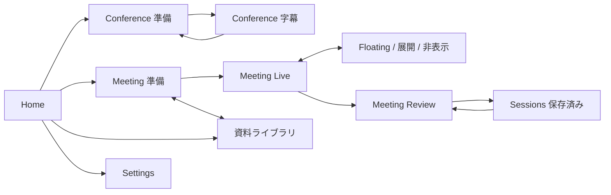

> 2026-11-12 現在: 永続資料ライブラリをローカル実装・自動検証・主要UI確認済み（[Draft PR #22](https://github.com/Ryuta1346/conflingo/pull/22)・未マージ）。会議への追加は保存時点のコピーで、更新・削除は使用中の会議と引用へ波及しない。AI送信許可は保存しない。狭幅実操作・VoiceOver全経路は未確認。以下の過去フェーズの記述は実施当時の履歴。[検証記録](../validation/knowledge-library.md)。

> Sessions追補（2026-11-11、計画承認済み・実装と主要検証済み）: MeetingとConferenceの明示保存・一覧・名前検索・読み取り専用再閲覧・Markdown再出力・削除を追加した。引用抜粋も保存し、元資料全体・音声・送信許可は保存しない。自動保存は行わない。423テスト成功、UI網羅確認は継続。[実装計画](sessions-implementation-plan.md)。以下のSessions持ち越し記述は従来の実施範囲。

# ConfLingo — 情報設計 v0.1

2026-11-08 / PR5-A モックの方向性承認済み（2026-11-08「OK」）。設計提案であり実装済み仕様ではない。

## 対象と観察

対象は14インチMacBookで会議に参加しながら読む人。Conferenceでは発話理解、Meetingでは必要な質問・回答と根拠の確認を優先する。これは既存計画から導いた利用シナリオであり、ユーザーインタビューの結果ではない。

`ContentView.swift`、`ControlBar.swift`、`TranscriptPane.swift`、`SetupView.swift`、`ConfLingoApp.swift`を静的確認した。

| 観察した事実 | 設計上の懸念（利用者実測なし） | 提案 |
|---|---|---|
| 言語・辞書入力・操作バーが字幕の下に常設 | 720×560で字幕の高さを圧迫しうる | 言語・辞書を準備画面/設定シートへ。字幕中は要約のみ |
| Start/Stop、Clear、Save、文字拡大、最前面が同じ列 | 破棄と停止の区別を強めたい | 下部に収集状態と停止、上部に表示/保存、Clearは停止後の確認つき |
| 辞書は作成・複製・改名・削除が可能 | 単にプリセット選択へ縮小すると機能欠落 | 準備画面に辞書編集ダイアログを残す |
| partialは斜体・薄色。翻訳待ち/失敗表示あり | 最終文との区別と失敗時の継続を保つ必要 | 「認識中」「翻訳待ち」「翻訳失敗」を文字で併記 |
| 認識/翻訳言語の変更はidleのみ | 会議中の意図せぬ再準備を防止する必要 | 停止して設定変更する経路を明示 |
| 保存はNSSavePanelでMarkdown出力。保存一覧なし | Sessionsを既存機能と誤認させない | Sessionsは将来のローカル保存機能として設計し、担当PRの判断を残す |
| 現状の実行状態はidle/preparing/listening/stopping | モックのpaused等を既存APIとして扱えない | MeetingのPauseは将来のUI契約。PR5-Cで停止/再開経路との対応を確認 |

## 画面マップ

常設サイドバーはホーム、Conference、Meeting、保存したセッション、資料ライブラリ、設定。通常幅では172px。狭幅では上部ナビゲーションへ移動し、アイコンだけにしない。進行中の別モード開始は停止確認を挟む。入力を二重起動しない。Preparation→Live→Reviewを同じ会議名と入力言語でつなぐ。

## 既存機能の移設表

| 現行機能 | 新UIの場所 | 維持する契約 | 担当 |
|---|---|---|---|
| 認識言語・翻訳先 | Conference準備 | 対応言語は実行時リスト。画面例の日英に制限しない。同一言語衝突の解決を維持 | 5-B |
| 文字起こしのみ・高速確定 | Conference準備 | 高速確定は文字起こしのみで選択、精度への影響を表示 | 5-B |
| 辞書選択・用語編集・追加・改名・複製・削除 | Conference準備の辞書管理 | 最後の辞書は削除不可。`term=訳語`を維持 | 5-B |
| Start/Stop・停止再試行 | 画面下部 | ⌘R。停止失敗を成功扱いしない。再開時の既存契約を維持 | 5-B |
| 原文/訳文・履歴・選択コピー | Conference字幕 | 読み返し中は自動スクロール停止、「最新へ」で復帰 | 5-B |
| Save Markdown | 上部「書き出す」 | 現行形式と保存ダイアログ、実行中の書き出し可 | 5-B |
| Clear | 停止後「字幕を消去」 | 確認→消去、キャンセルで保持 | 5-B |
| 最前面・文字サイズ | 上部表示操作 | 既存設定を継承。⌘＋/⌘−、10〜48pt | 5-B |
| セッション名 | 準備画面/字幕上部 | 空白時の既存ファイル命名規則を維持 | 5-B |
| モデル準備・取得状況 | 準備画面内の状態領域 | 認識対象の言語名を使う。進捗不明時は割合を捏造しない | 5-B |

## リリース段階（過去フェーズの範囲）

モックは完成形を示すため全画面を持つ。製品では未実装のナビゲーションを出さない。

- **5-B:** App Shell、Conference準備/字幕、既存設定・辞書・保存。Homeは実装済みConference開始のみ。Sessions一覧の新規永続化は含めない。
- **5-C:** Meeting準備/Live/ReviewのUI、コンパクト/展開/非表示。モックイベントから着手し、承認済み[PR5-C計画](pr5-c-implementation-plan.md)に従ってPR4接続コードとfake結合検証を先行する。実音声受入は延期、AI結合はPR6の受入後。Reviewの保存/候補確定はPR7に残す。
- **6（実装・モック検証済み、実API受入待ち）:** Geminiへの直接接続、利用者のAPIキーのKeychain保存、手動Ask AI、初期オフの自動提案。将来は複数Provider/運営Proxyを選べる設計にするが、今回は未実装の接続先を選択肢として出さない。詳細は[PR6計画](pr6-implementation-plan.md)・[検証記録](../validation/pr6-insights.md)。
- **7:** 候補確認・却下・復元、終了後の手動AI要約、Meeting Markdown書き出し。Sessionsの永続保存・一覧・再読込・削除は承認により別計画へ持ち越す。
- **8（ローカル実装・自動／非録音UI検証済み）:** 準備でMarkdown/Textを取り込み、Live/Reviewで検索・引用閲覧・取り外し。資料の送信許可は会議ごとに初期オフ、手動質問のみ。会議破棄・アプリ終了で資料を破棄し、PDF・永続ライブラリは後続。[検証記録](../validation/pr8-local-rag.md)。

## 主要な設計判断

**UI-001 / 連続する体験:** Goodwin D07-P02 / D07-R05 / D07-S01を参照。同梱ライブラリには画面構成と移動から詳細化する原典要約がある。今回の応用は準備→会議→振り返りを一つの名前・状態でつなぐこと。別案はモードごとの独立ウィンドウで、独立性は高いが共通設定の所在が分散する。会議切替の誤操作が観測されたら常設ナビを再検討する。

**UI-002 / 状態を分ける:** Nielsen D03-P01 / D03-R01 / D03-S01を参照。同梱原典要約の状態フィードバック原則から、入力・AI送信・保存を個別表示する。これは今回の推論。単一の「実行中」表示は簡潔だが、AI停止時に音声停止と誤認しうるため採用しない。次操作を説明できるか実利用で検証する。

**UI-003 / 会議中の情報量:** 提案を左の主領域、発話を右の補助領域へ。浮動表示は重要提案1件だけ。代案の字幕中心レイアウトはConferenceに採用。提案が頻繁に不必要と評価される場合は自動提案密度を見直す。効果は未測定。

## PR7 承認済み実装範囲（2026-11-10）

ユーザー「進めて」によりPR7を先行する。候補の確認／却下／未確認への復元、終了後に送信対象と予定要求数を確認して開始する手動AI要約、Meeting Markdown出力を実装する。AIは確認状態を変更しない。アプリ内Sessionsの永続保存・一覧・再読込・削除は別計画へ持ち越す。実音声受入と各Gateは未完了を維持する。PR7のローカル実装と自動・非録音UI確認は完了（310テスト／48 suites）。実API要約品質・実音声・マージは未完了。検証結果は`docs/validation/pr7-meeting-state.md`に記録。
